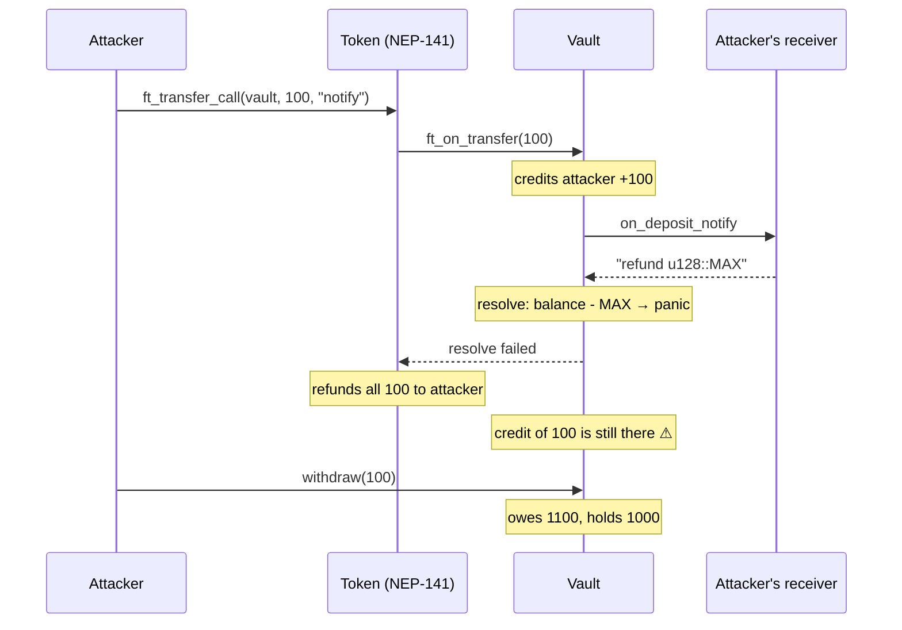
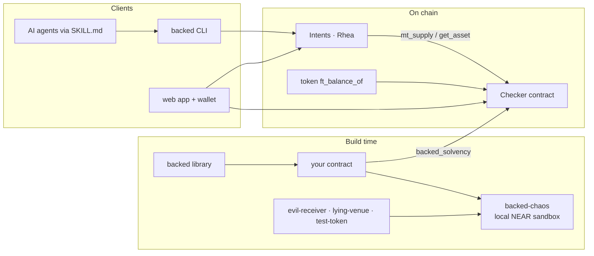

# Backed

**Does NEAR Intents actually hold every token it says you own? Backed checks, live, token by token.**

NEAR Intents keeps an internal ledger of user balances. The tokens behind those balances sit on separate token contracts. Backed reads both **at the same block** and compares them: what the protocol **owes** vs what it **holds**.

On mainnet, of 370 NEP-141 tokens in `intents.near`, **362 are fully backed, 3 are under-backed and 5 can't be read**. Anyone can re-run the check from the [web app](https://backed-near.vercel.app) or the CLI.

The same gap, a ledger that records more than the contract holds, is the bug behind three 2026 NEAR incidents worth **$22M+ exploited** ([sources below](#the-problem)). So Backed also ships the fix: a Rust library that stops contracts from writing that bug, and a sandbox harness that replays all three attacks to prove it.

| | |
|---|---|
| **Live app** | **<https://backed-near.vercel.app>**: live backing for every Intents token. No wallet needed to read. |
| **Live finding** | 362 of 370 NEP-141 tokens in `intents.near` fully backed; 3 under-backed, **each traced to the transaction that caused it** ([findings](docs/FINDINGS.md)) |
| **Replays** | 3 of 3 attacks break the naive vault; 3 of 3 are blocked by the Backed vault |
| **Checker contract** | [`simplekilt7490.testnet`](https://testnet.nearblocks.io/address/simplekilt7490.testnet): records backing on-chain, signed from your wallet |
| **Network** | Mainnet protocols are **read** live (read-only). The checker contract is deployed on **testnet**. |
| **Tests** | 36 unit tests + 3 sandbox replays, run in CI on every push |
| **Tracks** | Open Innovation · Unstoppable DeFi |

### Try it in one minute

1. Open <https://backed-near.vercel.app> → **Explore without a wallet**. You'll see every Intents token with owed, held and coverage.
2. Click **Verify** on any row. Your browser re-reads both numbers from NEAR mainnet RPC at one block.
3. Switch the filter to **issues** to see the under-backed and unreadable tokens.
4. Open **Replays** to watch each 2026 attack break a naive vault and fail against the Backed vault.

---

## Contents

- [The problem](#the-problem)
- [How one of these bugs works](#how-one-of-these-bugs-works)
- [What Backed does](#what-backed-does)
- [Proof: the attack replays](#proof-the-attack-replays)
- [Live on NEAR](#live-on-near)
- [The web app](#the-web-app)
- [Quick start](#quick-start)
- [Using the library](#using-the-library)
- [The checker contract](#the-checker-contract)
- [CLI reference](#cli-reference)
- [Daily monitoring](#daily-monitoring)
- [Roadmap](#roadmap)
- [For AI coding agents](#for-ai-coding-agents)
- [Architecture](#architecture)
- [Repository layout](#repository-layout)
- [Limits](#limits)
- [Hackathon](#hackathon)

---

## The problem

On NEAR, calls between contracts are **asynchronous**. Each step is a separate receipt, and **nothing rolls back automatically** when a later step fails. Protocols keep internal ledgers and hand-write compensation logic in callbacks. When that logic misses a case, the ledger records tokens the contract doesn't have, and an attacker withdraws them.

| Incident | Loss | What went wrong | Backed's rule |
|---|---|---|---|
| **NEAR Intents** (2026-10-01) | $3.8M | Over 23 failed deposits, a receiver asked for huge refunds. The refund log grew past NEAR's log limit (16,384 bytes), so `mt_resolve_deposit` failed. The token refunded the deposit, but the balance stayed recorded. | Resolve callbacks can't fail: refunds capped first, logs budgeted. |
| **Rhea Finance** (2026-04-16) | $18.4M | Margin trading validated a position against the swap route's *claimed* minimum output (summed across hops), then accepted a delivered amount about 4 million times smaller without comparing the two. | Balances and risk checks use only `Delivered` amounts. Crediting a `Claimed` one doesn't compile. |
| **SWEAT / HOT** (late April 2026) | 8.5M SWEAT (~$170–250K) | The token's `ft_resolve_transfer` refund callback lacked `#[private]`, so anyone could call it and take refunds nobody was owed. | Every callback is `#[private]`; refunds capped by deposit and balance. |

On Ethereum a transaction is all-or-nothing, so this family barely exists there. It's specific to NEAR's async model, and so is the fix.

These are bugs in individual apps, not in the NEAR protocol. NEAR's async design is deliberate (it's how NEAR scales), and its docs warn about callbacks. Each team fixed its own contract after the fact. What's missing is tooling that makes the safe pattern the default, plus a way for anyone to check backing continuously. That's the gap Backed fills.

**Sources**

- NEAR Intents: [regression test reproducing the failed `mt_resolve_deposit`](https://github.com/near/intents/commit/0c1a530c8da337008e28baa9987a816249d707e6) (PR #362, NEAR's own code); [fix removing deposit notifications](https://github.com/near/intents/commit/16d04f6ec4401263f8914638710260da50bb46b0) (PR #374); [official postmortem by Alex Shevchenko](https://x.com/AlexAuroraDev/status/2111124226962870770); [Crypto Times, 2026-10-17](https://www.cryptotimes.io/2026/10/17/near-intents-traces-3-8m-exploit-to-smart-contract-deposit-bug/); [walkthrough of the postmortem](https://thecoding.substack.com/p/near-intents-ghost-fund-postmortem). The team reports the funds were recovered.
- Rhea Finance: [The Block, post-mortem puts losses at $18.4M](https://www.theblock.co/news/ecosystems/2026-04-17-rhea-finance-post-mortem-exploit-losses-18-4-million-double-initial-estimates-397961); [Rekt, code-level analysis](https://rekt.news/rhea-finance-rekt). Part of the funds were returned or frozen.
- SWEAT / HOT: [Fireblocks, "Hunting Zero-Days at Machine Speed"](https://www.fireblocks.com/blog/near-zero-day-sweat-hot-token-exploit); [Fireblocks Q2 2026 threat report](https://www.fireblocks.com/report/crypto-threat-report-q2-2026). HOT was patched the same day.

More detail: [`Idea/01-problem-and-evidence.md`](Idea/01-problem-and-evidence.md).

## How one of these bugs works

The NEAR Intents pattern, simplified:



The vault's own books say everything is fine, but the token contract disagrees. Backed's invariant is that gap: **owed ≤ held**.

## What Backed does

| Part | Form | Job |
|---|---|---|
| [`backed`](crates/backed) | Rust crate for near-sdk contracts | **Prevent.** Balances only grow from verified amounts; callbacks are private, capped and can't panic; `owed ≤ held` is asserted on every state change; race-free `reconcile` compares books with the token's real balance. |
| [`backed-chaos`](crates/backed-chaos) | Test harness on a local NEAR sandbox | **Prove.** Deploys real contracts, replays each 2026 attack as real transactions, and reads owed vs held after every step. Failure catalog F1–F8 (out of gas, log overflow, absurd refunds, direct callback calls, lying venues, …). |
| [Checker](contracts/checker) | NEAR contract | **Verify.** Anyone can record on-chain whether a protocol holds what it owes, read from the protocol's and the token's own views. No trusted reporter. `Suspected` → `Confirmed` after 30+ blocks. |
| [CLI](cli), [web app](web), [skill](skill/SKILL.md) | Rust binary, React app, `SKILL.md` | **Use.** One-command checks, a live explorer with wallet-signed attestations, and AI coding agents that write NEAR contracts with Backed by default. |

## Proof: the attack replays

Each incident runs twice on a local NEAR sandbox: against [`naive-vault`](contracts/examples/naive-vault) (the three bug patterns, on purpose) and [`backed-vault`](contracts/examples/backed-vault) (same features, built on `backed`). The attacker uses real helper contracts: [`evil-receiver`](contracts/helpers/evil-receiver), [`lying-venue`](contracts/helpers/lying-venue), [`test-token`](contracts/helpers/test-token).

| Replay | Naive vault | Backed vault | What stopped it |
|---|---|---|---|
| **Intents**: absurd refund makes the resolve panic | **BROKEN**: owes 1000, holds 900; attacker **+100** | **SAFE**: owed = held at every step; gain 0 | Refund capped to the deposit, so the resolve can't panic |
| **SWEAT/HOT**: failing call chained into a public resolver | **BROKEN**: owes 1000, holds 900; attacker **+100** | **SAFE**: gain 0 | `#[private]` resolver rejects the outside call |
| **Rhea** (simplified): venue delivers 1, reports 900, route claims 900 | **BROKEN**: owes 1001, holds 101; attacker **+800** | **SAFE**: attacker loses 99 | Output credited only when the token delivers it |

Real output (`backed chaos --scenario intents`):

```
== replay_intents_log_limit vs Naive vault: BROKEN  (NEAR Intents, 2026-10-01, $3.8M)
  0. lp       ok     honest liquidity in the vault
       token-a.test.near    owed  1000 / held  1000
  1. attacker FAILED notify receiver asks for an absurd refund (u128::MAX) [F4]
       -> panicked at contracts/examples/naive-vault/src/lib.rs:73:38: attempt to subtract with overflow
       token-a.test.near    owed  1100 / held  1000  <-- SHORTFALL 100
  2. attacker ok     withdraw the credit the token already refunded
       token-a.test.near    owed  1000 / held   900  <-- SHORTFALL 100
  attacker gain: 100

== replay_intents_log_limit vs Backed vault: SAFE  (NEAR Intents, 2026-10-01, $3.8M)
  0. lp       ok     honest liquidity in the vault
       token-a.test.near    owed  1000 / held  1000
  1. attacker ok     notify receiver asks for an absurd refund (u128::MAX) [F4]
       token-a.test.near    owed  1000 / held  1000
  2. attacker FAILED withdraw the credit the token already refunded
       -> panicked at crates/backed/src/ledger.rs:243:9: BACKED: insufficient balance
       token-a.test.near    owed  1000 / held  1000
  attacker gain: 0
```

## Live on NEAR

### Mainnet readings (2026-10-23)

Backing = what the protocol holds (`ft_balance_of`) vs what it owes (its own views), **read at the same block height**, so in-flight transfers can't skew the result.

- **NEAR Intents** (`intents.near`, block 221,256,203): of 370 NEP-141 tokens, **362 fully backed**, **3 under-backed** (`ninu-4.nearlytrade.near`, `batman-4.nearlytrade.near`, test token `nvdastest.optimal-bone.near`), 5 unreadable (broken token contracts). We traced each shortfall to the transaction that created it ([findings](docs/FINDINGS.md)). Two memecoins charge a sell tax and then tell Intents the taxed part was "refunded"; Intents credits that refund although no tokens came back, so every taxed sell grows the gap by exactly the tax. The test token reported a deposit that never moved tokens. Small amounts, same bug as Rhea: a ledger crediting what it was told, not what arrived.
- **Rhea lending** (`contract.main.burrow.near`): every major token fully backed.

After the October exploit, NEAR's engineers wrote this exact check by hand: [`scripts/list_nep245_tokens.sh`](https://github.com/near/intents/blob/0c1a530c8da337008e28baa9987a816249d707e6/scripts/list_nep245_tokens.sh), added in the same commit as the bug's regression test, compares `mt_supply` with `intents.near`'s real balance on each token at one block height. Backed turns that one-off script into a product: it runs every day ([daily scan](#daily-monitoring)), can be recorded on-chain by anyone (the checker), works for any protocol that adopts a [standard view](docs/NEP-backed-solvency.md), and comes with a library that prevents the drift in the first place.

### Checker on testnet (2026-10-24)

The checker runs at [`simplekilt7490.testnet`](https://testnet.nearblocks.io/address/simplekilt7490.testnet) with the Burrow adapter for `contract.1638481328.burrow.testnet`:

| Token | Owed | Held | State | Tx |
|---|---|---|---|---|
| `wrap.testnet` | 1,252.78 NEAR | 20,115.29 NEAR | Healthy | [`GPi36PvK…`](https://testnet.nearblocks.io/txns/GPi36PvKK5sw95BDVa6f2tLoXXWRjRCXyEEgZbm2wHuG) |
| `usdc.fakes.testnet` | 103,906.634556 | 103,906.635640 | Healthy | [`5MGdqCBQ…`](https://testnet.nearblocks.io/txns/5MGdqCBQ296W7dyFogHrXKM6CFGDQLFBjxBoXRsseycE) |

**The standard, end to end:** the example [`backed-vault`](contracts/examples/backed-vault) runs at [`dev-20261025164059-33623400177607.testnet`](https://testnet.nearblocks.io/address/dev-20261025164059-33623400177607.testnet) with a real 0.01 wNEAR deposit ([`8HU7NBDS…`](https://testnet.nearblocks.io/txns/8HU7NBDSiu2NM2Z614E14DmDBcDp9C48DFTjLHYAkm6X)). It reports its books through [`backed_solvency`](docs/NEP-backed-solvency.md), and the checker reads them with no protocol-specific adapter: owed 0.01, held 0.01, **Healthy** ([`9mXCuLmj…`](https://testnet.nearblocks.io/txns/9mXCuLmjw5q2spxQGmWnqpQWuzzS3kdfxsJ341Jh4kPT)). It appears on the web app's Checker page. Recreate it with `live testnet <account> vault`.

The checker is deployed on testnet for this submission. The same contract and `examples/live.rs` deploy to mainnet unchanged, with the Intents (`Nep245Ledger`) and Burrow adapters.

## The web app

**Live: <https://backed-near.vercel.app>** (Vercel). Locally: `cd web && npm install && npm run dev` → <http://localhost:5173>. It's a static app with no backend: it reads NEAR RPC straight from the browser.

| Page | Route | What it does |
|---|---|---|
| **Home** | `#/` | The problem, the Intents replay side by side, and **Connect wallet** (MyNearWallet or Meteor) to enter the app |
| **Live backing** | `#/app` | Every NEP-141 token in NEAR Intents and Rhea lending: owed, held, coverage. **Verify** re-checks any row live at one block |
| **Checker** | `#/app/checker` | Attestations recorded on-chain, the breach log, a free same-block **Preview**, and **Sign & record**, which sends an `attest` transaction from your wallet |
| **Replays** | `#/app/replays` | All three attacks step by step, naive vs Backed, with owed/held bars |
| **Build** | `#/app/build` | The six safety rules, code examples, CLI usage, and the agent skill |

Reading never needs a wallet; signing does. The wallet connects on **testnet**, where the checker lives. The wallet code loads after first paint, so the home page is 84 KB gzipped. Light and dark themes; works at phone width.

## Quick start

Rust builds need **Linux, macOS or WSL** (near-sdk tests don't build with the Windows GNU toolchain). You need a recent stable Rust (tested with 1.97), the `wasm32-unknown-unknown` target, and [cargo-near](https://github.com/near/cargo-near) 0.22.

```bash
git clone https://github.com/rohan911438/Backed && cd Backed

# 1. Unit tests (36)
cargo test -p backed -p backed-checker -p backed-chaos -p naive-vault -p backed-vault

# 2. Build all contracts, then replay the three attacks on a local NEAR sandbox
bash scripts/build-wasm.sh
cargo run -p backed-cli --features chaos -- chaos
#   or as tests:  cargo test -p backed-chaos --features sandbox replay_ -- --nocapture

# 3. Check live mainnet protocols
cargo run -p backed-cli -- check intents.near --token usdt.tether-token.near
cargo run -p backed-cli -- scan-intents

# 4. The web app
cd web && npm install && npm run dev
```

The first sandbox build downloads the NEAR sandbox node and compiles near-workspaces (about 10–15 minutes); later runs take seconds.

## Using the library

```toml
[dependencies]
backed = { git = "https://github.com/rohan911438/Backed" }
```

```rust
use backed::{Claimed, Delivered, Ledger};

// Deposit: only a registered token can credit a balance.
let Some(amount) = Delivered::from_token_transfer(&token, amount.0)
else { return PromiseOrValue::Value(amount) };          // unknown token: refund all
self.ledger.credit(&token, &sender_id, amount);

// Deposit + follow-up call: the refund is capped and the resolve never panics.
let pending = self.ledger.credit_with_followup(&token, &sender_id, amount);
//   ...in the #[private] resolve:
let unused = self.ledger.finalize_followup(&pending, requested_refund);

// Withdraw: debit before the tokens leave, settle in a #[private] callback.
let pending = self.ledger.debit_for_withdraw(&token, &owner, Claimed(x));
//   ...callback:
self.ledger.settle_withdraw(&pending, is_promise_success());

// Books vs reality, with no false alarms from transfers in flight.
let ticket = self.ledger.begin_reconcile(&token);
//   ...callback with ft_balance_of:
self.ledger.finish_reconcile(&ticket, real_balance);   // Breach → withdrawals paused

// Standard view so anyone (and the checker) can verify you.
pub fn backed_solvency(&self, token: AccountId) -> Option<backed::Solvency> { self.ledger.solvency(&token) }
```

| Type | Guarantee |
|---|---|
| `Delivered` | Built only in `ft_on_transfer` from a trusted token, or from a self-callback's result. The only way to raise a balance. |
| `Claimed` | Anything a caller says. Usable for checks, never for crediting; there's no conversion to `Delivered`. |
| `Ledger` | Per-token `owed_total` and `shadow_held`; asserts `owed ≤ held` on every change; pauses withdrawals of a token in breach. |
| `LogBudget`, `cap_refund` | Keep resolve callbacks under NEAR's 16,384-byte / 100-entry log limit and refunds within the deposit. |

A complete example contract: [`contracts/examples/backed-vault`](contracts/examples/backed-vault/src/lib.rs).

## The checker contract

| Method | Who | What |
|---|---|---|
| `attest(target, token)` | anyone | Reads owed (protocol's view) and held (`ft_balance_of`), classifies, stores, emits an event. Attach 0.005 NEAR: the checker keeps only the storage the call adds and refunds the rest. |
| `get_status(target, token)` | view | `{ state, owed, held, last_block }`, with `state` = `Healthy`, `Suspected` or `Confirmed` |
| `list_breaches(from_index, limit)` | view | Every recorded shortfall |
| `register_self()` | protocol | Opt in: your contract implements `backed_solvency(token)`, so no custom adapter is needed |
| `set_adapter(target, kind)` | owner | Adapters: `Nep245Ledger` (Intents `mt_supply`), `BurrowLending` (Rhea `get_asset`), `BackedStandard` |
| `set_owner(owner)` / `get_owner()` | owner / view | Hand adapter management to a multisig or DAO |

On-chain reads land in different blocks, so a single reading can be off by in-flight transfers. A breach is therefore **Suspected** first and **Confirmed** only when a second attestation at least 30 blocks later still shows it. Promise results are read with bounded sizes, so a hostile target can't make the callback run out of gas.

Abuse resistance: every `attest` pays for the storage it adds and is refunded the rest, so repeated calls can't drain the checker's balance; a breach is logged only when a pair changes state, so they can't flood the log either.

Deploy and attest yourself: `cargo run -p backed-chaos --features sandbox --example live -- <testnet|mainnet> <account> <preflight|deploy|upgrade|attest|status> [target token]`. `preflight` prints the cost and checks the balance without spending anything; `upgrade` ships new code and keeps all records. The key is read from `~/.near-credentials/<network>/<account>.json`, never from the command line. Full mainnet checklist: [`docs/MAINNET.md`](docs/MAINNET.md).

## CLI reference

```
backed check <target> --token <token>... [--adapter nep245|burrow|backed] [--json] [--block <height>]
backed scan-intents [--limit N] [--parallel N] [--metadata] [--json]
backed chaos [--scenario intents|sweat|rhea] [--vault naive|backed|both] [--json]   # needs --features chaos
backed attest <target> <token> --signer <account> [--checker <account>]             # prints the near-cli command
backed mcp                                                                          # MCP server for AI agents (stdio, read-only)
```

`check` and `scan-intents` read owed and held **at the same block**, so results are exact. Add `--block <height>` with an archival RPC (`--rpc https://archival-rpc.mainnet.near.org`) to read any past block. `chaos` exits non-zero if a Backed vault ever breaks the invariant, which makes it usable as a CI gate.

Prebuilt binaries for Linux, macOS and Windows are attached to each [GitHub release](https://github.com/rohan911438/Backed/releases) (built by [`release.yml`](.github/workflows/release.yml) when a `v*` tag is pushed).

## Daily monitoring

[`monitor.yml`](.github/workflows/monitor.yml) runs once a day on GitHub Actions, free and with no keys: it scans every NEP-141 token in `intents.near`, refreshes the web app's snapshot, appends one line to [`data/backing-history.csv`](data/backing-history.csv), and **opens a GitHub issue** when a token becomes under-backed that wasn't the day before. To get the same alert in chat, add a `DISCORD_WEBHOOK_URL` secret, or `TELEGRAM_BOT_TOKEN` + `TELEGRAM_CHAT_ID`, in the repository settings.

## Roadmap

| Now | Next |
|---|---|
| Checker on testnet, same code ready for mainnet ([checklist](docs/MAINNET.md)) | Mainnet deploy with Intents and Rhea adapters |
| Adapters for Intents (`mt_supply`) and Rhea (`get_asset`) | Any protocol via the [`backed_solvency` standard](docs/NEP-backed-solvency.md) (draft NEP) |
| Daily scan, GitHub issue and optional Discord/Telegram alert on new shortfalls | Checker attestations recorded by the daily job |
| Rust library, agent skill, MCP server (`backed mcp`) | Wallet integration: warn before a deposit into an under-backed token |

## For AI coding agents

[`skill/SKILL.md`](skill/SKILL.md) is a skill for Claude Code, Codex and similar agents. When an agent writes a NEAR contract that holds tokens, it:

1. follows six rules (credit only delivered amounts, private callbacks, resolves never panic, debit before send, reject unknown tokens, expose `backed_solvency`);
2. uses the `backed` building blocks instead of hand-written accounting;
3. runs a review checklist on every change;
4. proves the result with `backed chaos`;
5. runs `backed check` before depositing into any protocol.

### MCP server for agents that move funds

`backed mcp` is a read-only [Model Context Protocol](https://modelcontextprotocol.io) server, so any AI agent (Claude, Cursor, a wallet agent) can check a protocol before it deposits. It never signs anything.

| Tool | What it answers |
|---|---|
| `check_backing(target, tokens, adapter?, block?)` | Owed vs held at one block, with a verdict: *BACKED*, or *UNDER-BACKED for X: don't deposit X without investigating* |
| `intents_backing_summary()` | Latest daily scan of every NEP-141 token in NEAR Intents |
| `checker_status(target, token, network?, checker?)` | What the on-chain checker last recorded: Healthy, Suspected or Confirmed |

```bash
cargo install --path cli            # or download a release binary
claude mcp add backed -- backed mcp # Claude Code; other clients: command "backed", args ["mcp"]
```

Example: asked "Is it safe to deposit BATMAN into NEAR Intents?", an agent calls `check_backing` and gets *"intents.near at block 221,565,674: UNDER-BACKED for batman-4.nearlytrade.near…"*, with the cause in [findings](docs/FINDINGS.md).

## Architecture



Full design: [`Idea/03-architecture.md`](Idea/03-architecture.md).

## Repository layout

```
crates/backed/          library: Ledger, Delivered/Claimed, capped refunds, LogBudget, reconcile
crates/backed-chaos/    failure catalog F1–F8, invariant oracle, three replays, NEAR sandbox runner,
                        live deploy/attest tool (examples/live.rs)
contracts/checker/      checker contract (Intents, Rhea and Backed-standard adapters)
contracts/examples/     naive-vault (the three bug patterns, on purpose) and backed-vault
contracts/helpers/      test-token, evil-receiver, lying-venue (used by the replays only)
cli/                    backed CLI: check, scan-intents, chaos, attest, mcp
web/                    Vite + React app: home, live backing, checker (wallet), replays, build
skill/SKILL.md          instructions for AI coding agents
docs/                   draft NEP for backed_solvency, mainnet deploy checklist
data/                   daily backing history (written by the monitor workflow)
scripts/build-wasm.sh   builds every contract with cargo-near
.github/workflows/      CI (unit tests, sandbox replays, web build), daily scan, CLI release; Pages deploy (manual; the live site is on Vercel)
Idea/                   design documents, incl. user workflows
```

## Limits

- Backed isn't general contract security: oracle manipulation, bad liquidation math, governance attacks and key theft are out of scope.
- It holds no one's funds and can't pause other protocols. A protocol has to choose to read the checker.
- A lending protocol's bad debt shows up as a backing gap only once it's written off. The library prevents the bug at the source; the checker is the backstop.
- An under-backed reading on a small token can come from burns or transfer fees. Treat it as a finding to investigate.
- `naive-vault` and the helper contracts are deliberately vulnerable. Never deploy them with real funds.

## Hackathon

- **Event:** NEAR HACKATHON, Nov 1–14, 2026 (rules in [`HACKATHON.md`](HACKATHON.md))
- **Tracks:** Open Innovation, Unstoppable DeFi
- **NEAR features used:** async receipts and callbacks, NEP-141 / 145 / 245 / 297, cross-contract views, near-sdk 5.x, near-workspaces sandbox, wallet-selector

### Design documents

| | |
|---|---|
| [Problem and evidence](Idea/01-problem-and-evidence.md) | [Product](Idea/02-product.md) |
| [Architecture](Idea/03-architecture.md) | [Innovations](Idea/04-innovations.md) |
| [Why NEAR](Idea/05-why-near.md) | [Competitors](Idea/06-competitors.md) |
| [Deliverables and plan](Idea/07-deliverables-and-plan.md) | [Design audit](Idea/08-design-audit.md) |
| [Demo and pitch](Idea/09-demo-and-pitch.md) | [User workflows](Idea/10-user-workflows.md) |

## License

MIT or Apache-2.0, at your option, as declared in `Cargo.toml`. See [`LICENSE-MIT`](LICENSE-MIT) and the [Apache-2.0 text](https://www.apache.org/licenses/LICENSE-2.0).
