<div align="center">

# Backed

### Never owe more than you hold.

**Proof of backing for NEAR protocols.** Backed reads what a protocol *owes* and what it *holds* at the same block, so anyone can check that every token is there. It also ships a Rust library that stops contracts from writing the bug that breaks this.

[Live app](https://backed-near.vercel.app) · [Findings](docs/FINDINGS.md) · [Claims and checks](#every-claim-and-how-to-check-it) · [Who it's for](#who-its-for-and-how-it-reaches-them) · [Roadmap](#roadmap-next-4-weeks)

</div>

---

**In one paragraph.** NEAR Intents keeps an internal ledger of user balances, and the tokens behind those balances sit on separate token contracts. When a cross-contract callback fails or trusts a reported number, the ledger can record tokens the contract doesn't hold. That bug family is behind three 2026 NEAR incidents worth **$22M+** ([sources](#the-problem)). Backed detects it from public chain state, with no reporter or oracle to trust, prevents it in code, and proves the fix by replaying all three attacks on a NEAR sandbox.

**Latest daily scan** (2026-11-09, block 223,790,368): of **387** NEP-141 tokens in `intents.near`, **380 are fully backed, 2 are under-backed and 5 can't be read**. The scan runs every day on GitHub Actions ([history](data/backing-history.csv)). Anyone can re-run it from the [web app](https://backed-near.vercel.app) or the CLI.

| | |
|---|---|
| **Live app** | **<https://backed-near.vercel.app>**: backing for every Intents token, Rhea lending and Ref Finance. No wallet needed to read. |
| **Live finding** | Every under-backed Intents token traced to the transaction that caused it, including a sell-tax refund flaw that is still growing the gap ([findings](docs/FINDINGS.md)) |
| **Replays** | 3 of 3 attacks break the naive vault; 3 of 3 are blocked by the Backed vault, in CI on every push |
| **Checker contract** | [`simplekilt7490.testnet`](https://testnet.nearblocks.io/address/simplekilt7490.testnet): anyone can record backing on-chain from their wallet |
| **Network** | Mainnet protocols are **read live** (read-only). The checker contract, which only records results, runs on **testnet**; the same wasm is ready for mainnet ([checklist](docs/MAINNET.md)). |
| **MCP server** | In the [official MCP Registry](https://registry.modelcontextprotocol.io/v0/servers?search=io.github.rohan911438/backed) as `io.github.rohan911438/backed`; hosted at `https://backed-near.vercel.app/api/mcp` |
| **Release** | CLI [v0.1.1](https://github.com/rohan911438/Backed/releases) for Linux, macOS and Windows, plus the checker wasm |
| **Tests** | 36 unit tests + 3 sandbox replays, run in CI on every push |
| **Tracks** | Open Innovation · Unstoppable DeFi |

### Every claim, and how to check it

| Claim | Check it yourself | What you should see |
|---|---|---|
| Backed reads live mainnet state, not a cached report | Web app → **Live backing** → **Verify** on any row | Owed and held re-read from mainnet RPC at one block, in your browser |
| Some Intents tokens are under-backed today | Web app → filter **issues**, or `backed scan-intents` | `ninu-4.nearlytrade.near` and `nvdastest.optimal-bone.near` under-backed |
| We know why | [`docs/FINDINGS.md`](docs/FINDINGS.md) and tx [`hmKEgaX2…`](https://nearblocks.io/txns/hmKEgaX2gX1pinNzAPisYny8Xk1WFg2Fz1KxMGcUSYv) | A 3% sell tax reported as "refunded"; Intents credits 1,133.80 NINU that never came back |
| The library stops the 2026 attacks | Web app → **Replays**, or `backed chaos` | Naive vault: BROKEN, attacker gains. Backed vault: SAFE, attacker gains 0 |
| The checker needs no trusted reporter | Web app → **Checker** → **Preview**, then **Sign & record** | The contract reads both numbers itself and stores Healthy, Suspected or Confirmed |
| It runs every day on its own | [`data/backing-history.csv`](data/backing-history.csv) and the commit log | One row and one "Daily backing scan" commit per day since 2026-10-25 |
| AI agents can use it | `claude mcp add --transport http backed https://backed-near.vercel.app/api/mcp`, then ask "Is it safe to deposit NINU into NEAR Intents?" | *UNDER-BACKED, don't deposit* with the block height and both numbers |
| NEAR's own engineers needed this check | [`scripts/list_nep245_tokens.sh`](https://github.com/near/intents/blob/0c1a530c8da337008e28baa9987a816249d707e6/scripts/list_nep245_tokens.sh) in near/intents | The same owed-vs-held comparison, written by hand after the October exploit |

### Try it in one minute

1. Open <https://backed-near.vercel.app> → **Explore without a wallet**. You'll see every Intents token with owed, held and coverage.
2. Click **Verify** on any row. Your browser re-reads both numbers from NEAR mainnet RPC at one block.
3. Switch the filter to **issues** to see the under-backed and unreadable tokens.
4. Open **Replays** to watch each 2026 attack break a naive vault and fail against the Backed vault.

Using an AI agent? Backed is in the [official MCP Registry](https://registry.modelcontextprotocol.io/v0/servers?search=io.github.rohan911438/backed) as **`io.github.rohan911438/backed`**. Connect the hosted server and ask whether a deposit is safe:

```bash
claude mcp add --transport http backed https://backed-near.vercel.app/api/mcp
```

---

## Why we built Backed

> **Never owe more than you hold.**
> *Trust what arrived, not what you were told.*

In 2026, three NEAR incidents cost users more than **$22M**, and they were all the same bug. A contract's internal books recorded tokens it didn't have: a refund callback that failed and left a credit behind (NEAR Intents, $3.8M), a swap that credited the amount the route *claimed* instead of what arrived (Rhea Finance, $18.4M), or a public callback anyone could call to collect refunds (SWEAT/HOT).

This bug family exists because NEAR is **asynchronous**: a transaction is a chain of receipts, and nothing rolls back on its own when a later step fails. Every team writes its own compensation logic, and every team can get it wrong. After the Intents exploit, NEAR's own engineers checked the damage by hand, with a shell script. There was no library that made the safe pattern the default, and no public, continuous way to ask a protocol *"do you actually hold what you owe me?"*

Backed is that missing layer. Three principles guide it:

| Principle | What it means in practice |
|---|---|
| **Delivered, not claimed** | A balance grows only from tokens that verifiably arrived. A number from a caller, a router, a venue or a token's reply is a `Claimed` value and can't be credited; the compiler enforces it. |
| **Verify, don't trust** | Anyone can check a protocol by reading its books and the token's real balance *at the same block*. No reporter, oracle or backend to trust, including us. |
| **Prevent first, detect second** | The library stops the bug from being written. The checker, daily scan and MCP server catch it anywhere it still exists. |

## What makes Backed different

**Not proof of reserves: proof of backing.** Proof-of-reserves dashboards show a balance someone reports. Backed compares two numbers that the chain itself provides, the protocol's own liabilities and the token contract's real holdings, at one block height. Then it ships the code that keeps them equal.

| | Audits | Proof-of-reserves dashboards | Generic monitoring | **Backed** |
|---|---|---|---|---|
| Prevents the bug in code | Finds it once, before launch | No | No | **Yes**: `Delivered`/`Claimed` types, capped refunds, private callbacks |
| Checks continuously after launch | No | Yes | Yes | **Yes**: daily scan, on-chain checker, live web app |
| Trust model | The auditor | The reporter | The vendor | **None**: both numbers read from NEAR at one block |
| Proves the fix against real attacks | No | No | No | **Yes**: all three 2026 attacks replayed on a NEAR sandbox |
| Usable by AI agents | No | No | Rarely | **Yes**: hosted MCP server and an agent skill |
| Cost to a protocol | High, per release | Varies | Subscription | **Free**: open source, one view method to adopt |

**Selling points, in one line each**

1. **It found something real.** On mainnet, it traced 3 under-backed NEAR Intents tokens to the exact transactions, including a live tax-refund accounting flaw ([findings](docs/FINDINGS.md)).
2. **Exact, not approximate.** Owed and held are read at the same block, so transfers in flight can't fake a shortfall or hide one.
3. **Preventive.** Crediting an unverified amount doesn't compile. Most security tools only watch.
4. **Proven.** 3 of 3 historical attacks break the naive vault and fail against the Backed vault, in CI on every push.
5. **Permissionless.** Anyone can check any supported protocol, and record the result on-chain from their wallet. No sign-up, no API key.
6. **Agent-native.** AI agents check before they deposit (MCP) and write safe NEAR contracts by default (`SKILL.md`).
7. **A path to a standard.** One view method, [`backed_solvency`](docs/NEP-backed-solvency.md), makes any protocol verifiable with no custom adapter.

## Who it's for and how it reaches them

Everything below works today, without a mainnet checker: every reading comes from live mainnet RPC, and the checker contract is only an optional on-chain record of those readings. Full plan: [`Idea/11-go-to-market.md`](Idea/11-go-to-market.md).

### Target users, in the order we go after them

| # | Who | Their problem | What they use today | First step |
|---|---|---|---|---|
| 1 | **NEAR DeFi protocols with an internal ledger** (Intents, Rhea lending, Ref, new vaults and lending markets) | One bad callback can cost millions, and there is no public way to show users the books are backed | Web app and daily scan (no code change); `backed` library and `backed chaos` for new code | We share the finding with the protocol; they add `backed_solvency` (one view method) |
| 2 | **AI agents and agent wallets that move funds** | An agent can't tell whether a deposit target is solvent | Hosted MCP server: `check_backing` returns *BACKED* or *UNDER-BACKED, don't deposit* | One line: `claude mcp add --transport http backed …`, or install from the MCP Registry |
| 3 | **NEAR contract developers and AI coding agents** | Async compensation logic is hand-written and easy to get wrong | `backed` crate, `skill/SKILL.md`, attack replays in CI | Add the git dependency; drop `SKILL.md` into the agent's skills |
| 4 | **Wallets and deposit front-ends** | Users deposit into contracts they can't inspect | CLI `--json` and the MCP endpoint as a pre-deposit check | Call the check before showing "Deposit" |
| 5 | **Auditors and security teams** | Audits are one-off; NEAR runtime failures (log limit, out-of-gas, lying venues) are hard to reproduce | `backed-chaos` failure catalog F1–F8 and the replays | Run the replays against a client's vault in the sandbox |

### How someone starts, by role

| You are | Do this | You get |
|---|---|---|
| A user | Open <https://backed-near.vercel.app> → **Live backing** | Owed vs held for every Intents token; **Verify** re-reads it live |
| An agent builder | `claude mcp add --transport http backed https://backed-near.vercel.app/api/mcp` | A pre-deposit tool call with a verdict, block height and numbers |
| A protocol team | `backed check <your-contract> --token <token> --json` in a cron, or fork the repo and keep [`monitor.yml`](.github/workflows/monitor.yml) | A daily backing check with GitHub issue, Discord or Telegram alerts |
| A contract developer | `backed = { git = "https://github.com/rohan911438/Backed" }` and follow [`backed-vault`](contracts/examples/backed-vault/src/lib.rs) | Balances that only grow from delivered tokens; callbacks that can't panic |
| An auditor | `backed chaos --scenario intents` | A step-by-step owed/held trace of each attack |

### Distribution and sustainability

- **Channels:** the official MCP Registry (live), GitHub releases (live), the `backed_solvency` NEP discussion with protocol teams, responsible disclosure to NEAR Intents as the first protocol conversation, and the agent skill in AI coding tools.
- **Cost to run:** close to zero. The web app is static, the scan runs on free GitHub Actions, and the MCP endpoint is one serverless function.
- **Model:** the library, checker, CLI and MCP server stay free and open source. Options to fund the work: ecosystem grants for the NEP and checker, and paid custom adapters and alerting for protocols that want a checker integration done for them.

---

## Contents

- [Every claim, and how to check it](#every-claim-and-how-to-check-it)
- [Why we built Backed](#why-we-built-backed)
- [What makes Backed different](#what-makes-backed-different)
- [Who it's for and how it reaches them](#who-its-for-and-how-it-reaches-them)
- [The problem](#the-problem)
- [How one of these bugs works](#how-one-of-these-bugs-works)
- [What Backed does](#what-backed-does)
- [Proof: the attack replays](#proof-the-attack-replays)
- [Live on NEAR](#live-on-near)
- [The web app](#the-web-app)
- [Quick start](#quick-start)
- [Using the library](#using-the-library)
- [The checker contract](#the-checker-contract)
- [CLI reference](#cli-reference)
- [Daily monitoring](#daily-monitoring)
- [For AI coding agents](#for-ai-coding-agents)
- [Architecture and workflows](#architecture-and-workflows)
- [Roadmap: next 4 weeks](#roadmap-next-4-weeks)
- [Repository layout](#repository-layout)
- [Limits](#limits)
- [Hackathon](#hackathon)

---

## The problem

On NEAR, calls between contracts are **asynchronous**. Each step is a separate receipt, and **nothing rolls back automatically** when a later step fails. Protocols keep internal ledgers and hand-write compensation logic in callbacks. When that logic misses a case, the ledger records tokens the contract doesn't have, and an attacker withdraws them.

| Incident | Loss | What went wrong | Backed's rule |
|---|---|---|---|
| **NEAR Intents** (2026-10-01) | $3.8M | Over 23 failed deposits, a receiver asked for huge refunds. The refund log grew past NEAR's log limit (16,384 bytes), so `mt_resolve_deposit` failed. The token refunded the deposit, but the balance stayed recorded. | Resolve callbacks can't fail: refunds capped first, logs budgeted. |
| **Rhea Finance** (2026-04-16) | $18.4M | Margin trading validated a position against the swap route's *claimed* minimum output (summed across hops), then accepted a delivered amount about 4 million times smaller without comparing the two. | Balances and risk checks use only `Delivered` amounts. Crediting a `Claimed` one doesn't compile. |
| **SWEAT / HOT** (late April 2026) | 8.5M SWEAT (~$170–250K) | The token's `ft_resolve_transfer` refund callback lacked `#[private]`, so anyone could call it and take refunds nobody was owed. | Every callback is `#[private]`; refunds capped by deposit and balance. |

On Ethereum a transaction is all-or-nothing, so this family barely exists there. It's specific to NEAR's async model, and so is the fix.

These are bugs in individual apps, not in the NEAR protocol. NEAR's async design is deliberate (it's how NEAR scales), and its docs warn about callbacks. Each team fixed its own contract after the fact. What's missing is tooling that makes the safe pattern the default, plus a way for anyone to check backing continuously. That's the gap Backed fills.

**Sources**

- NEAR Intents: [regression test reproducing the failed `mt_resolve_deposit`](https://github.com/near/intents/commit/0c1a530c8da337008e28baa9987a816249d707e6) (PR #362, NEAR's own code); [fix removing deposit notifications](https://github.com/near/intents/commit/16d04f6ec4401263f8914638710260da50bb46b0) (PR #374); [official postmortem by Alex Shevchenko](https://x.com/AlexAuroraDev/status/2111124226962870770); [Crypto Times, 2026-10-17](https://www.cryptotimes.io/2026/10/17/near-intents-traces-3-8m-exploit-to-smart-contract-deposit-bug/); [walkthrough of the postmortem](https://thecoding.substack.com/p/near-intents-ghost-fund-postmortem). The team reports the funds were recovered.
- Rhea Finance: [The Block, post-mortem puts losses at $18.4M](https://www.theblock.co/news/ecosystems/2026-04-17-rhea-finance-post-mortem-exploit-losses-18-4-million-double-initial-estimates-397961); [Rekt, code-level analysis](https://rekt.news/rhea-finance-rekt). Part of the funds were returned or frozen.
- SWEAT / HOT: [Fireblocks, "Hunting Zero-Days at Machine Speed"](https://www.fireblocks.com/blog/near-zero-day-sweat-hot-token-exploit); [Fireblocks Q2 2026 threat report](https://www.fireblocks.com/report/crypto-threat-report-q2-2026). HOT was patched the same day.

More detail: [`Idea/01-problem-and-evidence.md`](Idea/01-problem-and-evidence.md).

## How one of these bugs works

The NEAR Intents pattern, simplified:

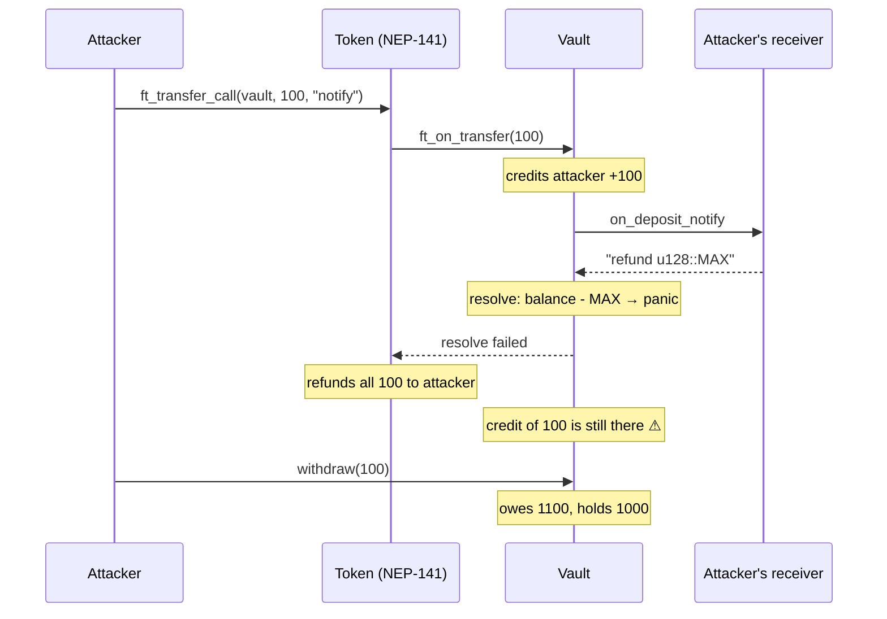

The vault's own books say everything is fine, but the token contract disagrees. Backed's invariant is that gap: **owed ≤ held**.

## What Backed does

| Part | Form | Job |
|---|---|---|
| [`backed`](crates/backed) | Rust crate for near-sdk contracts | **Prevent.** Balances only grow from verified amounts; callbacks are private, capped and can't panic; `owed ≤ held` is asserted on every state change; race-free `reconcile` compares books with the token's real balance. |
| [`backed-chaos`](crates/backed-chaos) | Test harness on a local NEAR sandbox | **Prove.** Deploys real contracts, replays each 2026 attack as real transactions, and reads owed vs held after every step. Failure catalog F1–F8 (out of gas, log overflow, absurd refunds, direct callback calls, lying venues, …). |
| [Checker](contracts/checker) | NEAR contract | **Verify.** Anyone can record on-chain whether a protocol holds what it owes, read from the protocol's and the token's own views. No trusted reporter. `Suspected` → `Confirmed` after 30+ blocks. |
| [CLI](cli), [web app](web), [skill](skill/SKILL.md) | Rust binary, React app, `SKILL.md` | **Use.** One-command checks, a live explorer with wallet-signed attestations, and AI coding agents that write NEAR contracts with Backed by default. |
| [Daily scan](.github/workflows/monitor.yml), [MCP server](api/mcp.ts) | GitHub Actions job, Vercel function | **Watch.** Every Intents token checked daily with history and alerts; AI agents check backing before they deposit. |

## Proof: the attack replays

Each incident runs twice on a local NEAR sandbox: against [`naive-vault`](contracts/examples/naive-vault) (the three bug patterns, on purpose) and [`backed-vault`](contracts/examples/backed-vault) (same features, built on `backed`). The attacker uses real helper contracts: [`evil-receiver`](contracts/helpers/evil-receiver), [`lying-venue`](contracts/helpers/lying-venue), [`test-token`](contracts/helpers/test-token).

| Replay | Naive vault | Backed vault | What stopped it |
|---|---|---|---|
| **Intents**: absurd refund makes the resolve panic | **BROKEN**: owes 1000, holds 900; attacker **+100** | **SAFE**: owed = held at every step; gain 0 | Refund capped to the deposit, so the resolve can't panic |
| **SWEAT/HOT**: failing call chained into a public resolver | **BROKEN**: owes 1000, holds 900; attacker **+100** | **SAFE**: gain 0 | `#[private]` resolver rejects the outside call |
| **Rhea** (simplified): venue delivers 1, reports 900, route claims 900 | **BROKEN**: owes 1001, holds 101; attacker **+800** | **SAFE**: attacker loses 99 | Output credited only when the token delivers it |

Real output (`backed chaos --scenario intents`):

```
== replay_intents_log_limit vs Naive vault: BROKEN  (NEAR Intents, 2026-10-01, $3.8M)
  0. lp       ok     honest liquidity in the vault
       token-a.test.near    owed  1000 / held  1000
  1. attacker FAILED notify receiver asks for an absurd refund (u128::MAX) [F4]
       -> panicked at contracts/examples/naive-vault/src/lib.rs:73:38: attempt to subtract with overflow
       token-a.test.near    owed  1100 / held  1000  <-- SHORTFALL 100
  2. attacker ok     withdraw the credit the token already refunded
       token-a.test.near    owed  1000 / held   900  <-- SHORTFALL 100
  attacker gain: 100

== replay_intents_log_limit vs Backed vault: SAFE  (NEAR Intents, 2026-10-01, $3.8M)
  0. lp       ok     honest liquidity in the vault
       token-a.test.near    owed  1000 / held  1000
  1. attacker ok     notify receiver asks for an absurd refund (u128::MAX) [F4]
       token-a.test.near    owed  1000 / held  1000
  2. attacker FAILED withdraw the credit the token already refunded
       -> panicked at crates/backed/src/ledger.rs:243:9: BACKED: insufficient balance
       token-a.test.near    owed  1000 / held  1000
  attacker gain: 0
```

## Live on NEAR

### Mainnet readings

Backing = what the protocol holds (`ft_balance_of`) vs what it owes (its own views), **read at the same block height**, so in-flight transfers can't skew the result.

- **NEAR Intents, latest** (`intents.near`, 2026-11-09, block 223,790,368): of 387 NEP-141 tokens, **380 fully backed**, **2 under-backed** (`ninu-4.nearlytrade.near` and test token `nvdastest.optimal-bone.near`), 5 unreadable (broken token contracts). `batman-4.nearlytrade.near` was under-backed until 2026-10-30, when its gap closed. Every day's result is in [`data/backing-history.csv`](data/backing-history.csv).
- **NEAR Intents, first scan** (block 221,256,203, 2026-10-23): of 370 NEP-141 tokens, **362 fully backed**, **3 under-backed** (NINU, BATMAN and tNVDAs), 5 unreadable. We traced each shortfall to the transaction that created it ([findings](docs/FINDINGS.md)). Two memecoins charge a sell tax and then tell Intents the taxed part was "refunded"; Intents credits that refund although no tokens came back, so every taxed sell grows the gap by exactly the tax. The test token reported a deposit that never moved tokens. Small amounts, same bug as Rhea: a ledger crediting what it was told, not what arrived.
- **Rhea lending** (`contract.main.burrow.near`): every major token fully backed.
- **Ref Finance** (`v2.ref-finance.near`, block 221,566,295): all 8,991 pools read at one block. For 13 major tokens, holdings are above the pools' total reserves. Ref has no view for the total of users' internal deposits, so this is a **floor** check: it can prove a shortfall, not full backing (`backed scan-ref`).

**Which NEAR protocols can be checked at all?** We listed the view methods of the largest ones. Intents (`mt_supply`) and Rhea lending (`get_asset`) expose a total of what they owe per token, so they can be checked exactly. Ref Finance exposes pool reserves but not user deposits (floor only). Ref DCL and Orderly expose only per-user balances, with no total. Liquid staking (LiNEAR, Meta Pool, rNEAR) holds native NEAR in validators, so token backing doesn't apply. Most protocols can't be verified by an outsider today; that's what the [`backed_solvency` standard](docs/NEP-backed-solvency.md) is for.

After the October exploit, NEAR's engineers wrote this exact check by hand: [`scripts/list_nep245_tokens.sh`](https://github.com/near/intents/blob/0c1a530c8da337008e28baa9987a816249d707e6/scripts/list_nep245_tokens.sh), added in the same commit as the bug's regression test, compares `mt_supply` with `intents.near`'s real balance on each token at one block height. Backed turns that one-off script into a product: it runs every day ([daily scan](#daily-monitoring)), can be recorded on-chain by anyone (the checker), works for any protocol that adopts a [standard view](docs/NEP-backed-solvency.md), and comes with a library that prevents the drift in the first place.

### Checker on testnet (2026-10-24)

The checker runs at [`simplekilt7490.testnet`](https://testnet.nearblocks.io/address/simplekilt7490.testnet) with the Burrow adapter for `contract.1638481328.burrow.testnet`:

| Token | Owed | Held | State | Tx |
|---|---|---|---|---|
| `wrap.testnet` | 1,252.78 NEAR | 20,115.29 NEAR | Healthy | [`GPi36PvK…`](https://testnet.nearblocks.io/txns/GPi36PvKK5sw95BDVa6f2tLoXXWRjRCXyEEgZbm2wHuG) |
| `usdc.fakes.testnet` | 103,906.634556 | 103,906.635640 | Healthy | [`5MGdqCBQ…`](https://testnet.nearblocks.io/txns/5MGdqCBQ296W7dyFogHrXKM6CFGDQLFBjxBoXRsseycE) |

**The standard, end to end:** the example [`backed-vault`](contracts/examples/backed-vault) runs at [`dev-20261025164059-33623400177607.testnet`](https://testnet.nearblocks.io/address/dev-20261025164059-33623400177607.testnet) with a real 0.01 wNEAR deposit ([`8HU7NBDS…`](https://testnet.nearblocks.io/txns/8HU7NBDSiu2NM2Z614E14DmDBcDp9C48DFTjLHYAkm6X)). It reports its books through [`backed_solvency`](docs/NEP-backed-solvency.md), and the checker reads them with no protocol-specific adapter: owed 0.01, held 0.01, **Healthy** ([`9mXCuLmj…`](https://testnet.nearblocks.io/txns/9mXCuLmjw5q2spxQGmWnqpQWuzzS3kdfxsJ341Jh4kPT)). It appears on the web app's Checker page. Recreate it with `live testnet <account> vault`.

The checker is deployed on testnet for this submission. The same contract and `examples/live.rs` deploy to mainnet unchanged, with the Intents (`Nep245Ledger`) and Burrow adapters.

## The web app

**Live: <https://backed-near.vercel.app>** (Vercel). Locally: `cd web && npm install && npm run dev` → <http://localhost:5173>. It's a static app with no backend: it reads NEAR RPC straight from the browser.

| Page | Route | What it does |
|---|---|---|
| **Home** | `#/` | The problem, the Intents replay side by side, and **Connect wallet** (MyNearWallet or Meteor) to enter the app |
| **Live backing** | `#/app` | Every NEP-141 token in NEAR Intents, Rhea lending, and Ref Finance (reserves floor): owed, held, coverage. **Verify** re-checks any row live at one block |
| **Checker** | `#/app/checker` | Attestations recorded on-chain, the breach log, a free same-block **Preview**, and **Sign & record**, which sends an `attest` transaction from your wallet |
| **Replays** | `#/app/replays` | All three attacks step by step, naive vs Backed, with owed/held bars |
| **Build** | `#/app/build` | Why we built Backed, our principles, what makes it different, the roadmap, how to start (MCP, library, standard), and the six rules |

Reading never needs a wallet; signing does. The wallet connects on **testnet**, where the checker lives. The wallet code loads after first paint, so the home page is 84 KB gzipped. Light and dark themes; works at phone width.

## Quick start

Rust builds need **Linux, macOS or WSL** (near-sdk tests don't build with the Windows GNU toolchain). You need a recent stable Rust (tested with 1.97), the `wasm32-unknown-unknown` target, and [cargo-near](https://github.com/near/cargo-near) 0.22.

```bash
git clone https://github.com/rohan911438/Backed && cd Backed

# 1. Unit tests (36)
cargo test -p backed -p backed-checker-logic -p backed-checker -p backed-chaos -p naive-vault -p backed-vault

# 2. Build all contracts, then replay the three attacks on a local NEAR sandbox
bash scripts/build-wasm.sh
cargo run -p backed-cli --features chaos -- chaos
#   or as tests:  cargo test -p backed-chaos --features sandbox replay_ -- --nocapture

# 3. Check live mainnet protocols
cargo run -p backed-cli -- check intents.near --token usdt.tether-token.near
cargo run -p backed-cli -- scan-intents

# 4. The web app
cd web && npm install && npm run dev
```

The first sandbox build downloads the NEAR sandbox node and compiles near-workspaces (about 10–15 minutes); later runs take seconds.

## Using the library

```toml
[dependencies]
backed = { git = "https://github.com/rohan911438/Backed" }
```

```rust
use backed::{Claimed, Delivered, Ledger};

// Deposit: only a registered token can credit a balance.
let Some(amount) = Delivered::from_token_transfer(&token, amount.0)
else { return PromiseOrValue::Value(amount) };          // unknown token: refund all
self.ledger.credit(&token, &sender_id, amount);

// Deposit + follow-up call: the refund is capped and the resolve never panics.
let pending = self.ledger.credit_with_followup(&token, &sender_id, amount);
//   ...in the #[private] resolve:
let unused = self.ledger.finalize_followup(&pending, requested_refund);

// Withdraw: debit before the tokens leave, settle in a #[private] callback.
let pending = self.ledger.debit_for_withdraw(&token, &owner, Claimed(x));
//   ...callback:
self.ledger.settle_withdraw(&pending, is_promise_success());

// Books vs reality, with no false alarms from transfers in flight.
let ticket = self.ledger.begin_reconcile(&token);
//   ...callback with ft_balance_of:
self.ledger.finish_reconcile(&ticket, real_balance);   // Breach → withdrawals paused

// Standard view so anyone (and the checker) can verify you.
pub fn backed_solvency(&self, token: AccountId) -> Option<backed::Solvency> { self.ledger.solvency(&token) }
```

| Type | Guarantee |
|---|---|
| `Delivered` | Built only in `ft_on_transfer` from a trusted token, or from a self-callback's result. The only way to raise a balance. |
| `Claimed` | Anything a caller says. Usable for checks, never for crediting; there's no conversion to `Delivered`. |
| `Ledger` | Per-token `owed_total` and `shadow_held`; asserts `owed ≤ held` on every change; pauses withdrawals of a token in breach. |
| `LogBudget`, `cap_refund` | Keep resolve callbacks under NEAR's 16,384-byte / 100-entry log limit and refunds within the deposit. |

A complete example contract: [`contracts/examples/backed-vault`](contracts/examples/backed-vault/src/lib.rs).

## The checker contract

| Method | Who | What |
|---|---|---|
| `attest(target, token)` | anyone | Reads owed (protocol's view) and held (`ft_balance_of`), classifies, stores, emits an event. Attach 0.005 NEAR: the checker keeps only the storage the call adds and refunds the rest. |
| `get_status(target, token)` | view | `{ state, owed, held, last_block }`, with `state` = `Healthy`, `Suspected` or `Confirmed` |
| `list_breaches(from_index, limit)` | view | Every recorded shortfall |
| `register_self()` | protocol | Opt in: your contract implements `backed_solvency(token)`, so no custom adapter is needed |
| `set_adapter(target, kind)` | owner | Adapters: `Nep245Ledger` (Intents `mt_supply`), `BurrowLending` (Rhea `get_asset`), `BackedStandard` |
| `set_owner(owner)` / `get_owner()` | owner / view | Hand adapter management to a multisig or DAO |

On-chain reads land in different blocks, so a single reading can be off by in-flight transfers. A breach is therefore **Suspected** first and **Confirmed** only when a second attestation at least 30 blocks later still shows it. Promise results are read with bounded sizes, so a hostile target can't make the callback run out of gas.

Abuse resistance: every `attest` pays for the storage it adds and is refunded the rest, so repeated calls can't drain the checker's balance; a breach is logged only when a pair changes state, so they can't flood the log either.

Deploy and attest yourself: `cargo run -p backed-chaos --features sandbox --example live -- <testnet|mainnet> <account> <preflight|deploy|upgrade|attest|status> [target token]`. `preflight` prints the cost and checks the balance without spending anything; `upgrade` ships new code and keeps all records. The key is read from `~/.near-credentials/<network>/<account>.json`, never from the command line. Full mainnet checklist: [`docs/MAINNET.md`](docs/MAINNET.md).

## CLI reference

```
backed check <target> --token <token>... [--adapter nep245|burrow|backed] [--json] [--block <height>]
backed scan-intents [--limit N] [--parallel N] [--metadata] [--json]
backed scan-ref [--token <token>...] [--json]                                       # Ref Finance: pool reserves (floor) vs holdings
backed chaos [--scenario intents|sweat|rhea] [--vault naive|backed|both] [--json]   # needs --features chaos
backed attest <target> <token> --signer <account> [--checker <account>]             # prints the near-cli command
backed mcp                                                                          # MCP server for AI agents (stdio, read-only)
```

`check` and `scan-intents` read owed and held **at the same block**, so results are exact. Add `--block <height>` with an archival RPC (`--rpc https://archival-rpc.mainnet.near.org`) to read any past block. `chaos` exits non-zero if a Backed vault ever breaks the invariant, which makes it usable as a CI gate.

Prebuilt binaries for Linux, macOS and Windows are attached to each [GitHub release](https://github.com/rohan911438/Backed/releases) (built by [`release.yml`](.github/workflows/release.yml) when a `v*` tag is pushed).

## Daily monitoring

[`monitor.yml`](.github/workflows/monitor.yml) runs once a day on GitHub Actions, free and with no keys: it scans every NEP-141 token in `intents.near`, refreshes the web app's snapshot, appends one line to [`data/backing-history.csv`](data/backing-history.csv), and **opens a GitHub issue** when a token becomes under-backed that wasn't the day before. To get the same alert in chat, add a `DISCORD_WEBHOOK_URL` secret, or `TELEGRAM_BOT_TOKEN` + `TELEGRAM_CHAT_ID`, in the repository settings.

## For AI coding agents

[`skill/SKILL.md`](skill/SKILL.md) is a skill for Claude Code, Codex and similar agents. When an agent writes a NEAR contract that holds tokens, it:

1. follows six rules (credit only delivered amounts, private callbacks, resolves never panic, debit before send, reject unknown tokens, expose `backed_solvency`);
2. uses the `backed` building blocks instead of hand-written accounting;
3. runs a review checklist on every change;
4. proves the result with `backed chaos`;
5. runs `backed check` before depositing into any protocol.

### MCP server for agents that move funds

Backed is a read-only [Model Context Protocol](https://modelcontextprotocol.io) server, so any AI agent (Claude, Cursor, a wallet agent) can check a protocol before it deposits. It never signs anything. There are two ways to run it, with the same tools:

| Tool | What it answers |
|---|---|
| `check_backing(target, tokens, adapter?, block?)` | Owed vs held at one block (`block` for past heights: local server only), with a verdict: *BACKED*, or *UNDER-BACKED for X: don't deposit X without investigating* |
| `intents_backing_summary()` | Latest daily scan of every NEP-141 token in NEAR Intents |
| `checker_status(target, token, network?, checker?)` | What the on-chain checker last recorded: Healthy, Suspected or Confirmed |

**Hosted (nothing to install).** A public Streamable HTTP endpoint at `https://backed-near.vercel.app/api/mcp`:

```bash
claude mcp add --transport http backed https://backed-near.vercel.app/api/mcp
```

For Cursor, VS Code or any other client that takes a JSON config:

```json
{ "mcpServers": { "backed": { "url": "https://backed-near.vercel.app/api/mcp" } } }
```

**Listed in the official MCP Registry** as [`io.github.rohan911438/backed`](https://registry.modelcontextprotocol.io/v0/servers?search=io.github.rohan911438/backed) (version 0.1.0, published 2026-10-25), so registry-aware clients can find it by name. Its source is [`api/mcp.ts`](api/mcp.ts) and its registry entry is [`server.json`](server.json). To publish a new version: bump `version` in `server.json`, then run `mcp-publisher login github` and `mcp-publisher publish`.

**Local (stdio, from the CLI).** `backed mcp`, for agents that shouldn't depend on our server or need past blocks:

```bash
cargo install --path cli            # or download a release binary
claude mcp add backed -- backed mcp # Claude Code; other clients: command "backed", args ["mcp"]
```

Example: asked "Is it safe to deposit BATMAN into NEAR Intents?", an agent calls `check_backing` and gets *"intents.near at block 221,565,674: UNDER-BACKED for batman-4.nearlytrade.near…"*, with the cause in [findings](docs/FINDINGS.md).

## Architecture and workflows

### 1. System architecture

Backed has four layers: **prevent** (library), **prove** (attack replays), **verify** (checker, scans) and **use** (CLI, web, MCP, skill). Everything on the right reads public NEAR state; nothing holds user funds.

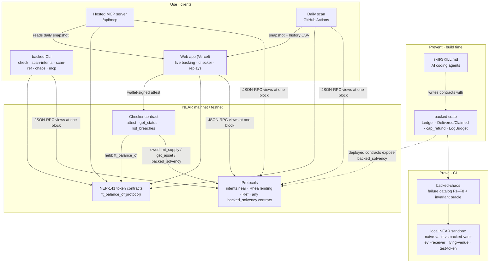

### 2. How a backing check works

The one idea behind every reading: ask the chain for **one final block height**, then read both numbers *at that height*. Two reads at different heights could disagree only because a transfer was in flight.

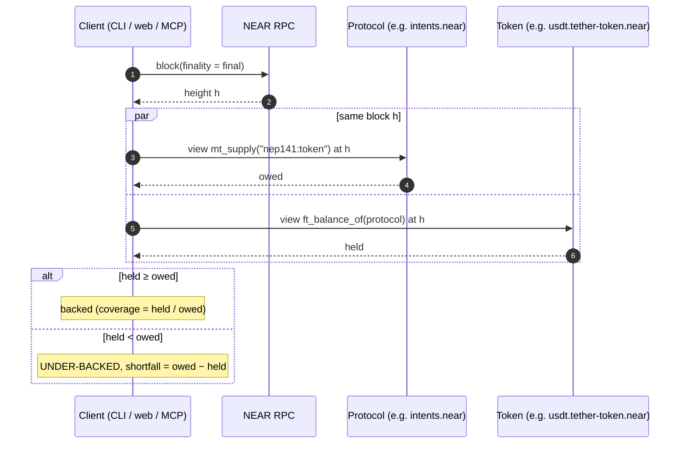

| Protocol | `owed` comes from | Precision |
|---|---|---|
| NEAR Intents | `mt_supply("nep141:<token>")` | Exact |
| Rhea lending | `get_asset(token)`: supplied + reserved + protocol fee − borrowed | Exact |
| Ref Finance | Sum of `get_pools` reserves over all 8,991 pools | Floor (user deposits are owed on top) |
| Any adopter | `backed_solvency(token).owed` | Exact |

### 3. On-chain attestation (checker contract)

Anyone can record a reading on-chain. The checker reads both numbers itself through cross-contract views, so the caller can't influence the result.

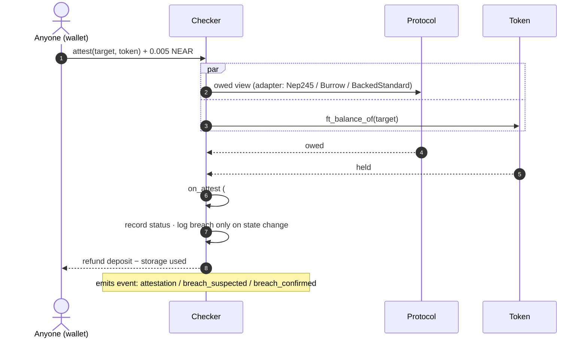

Cross-contract reads land in slightly different blocks, so one bad reading isn't enough to call a breach:

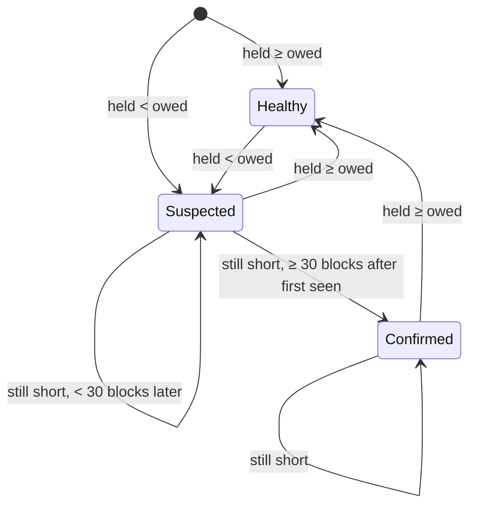

### 4. Inside a Backed contract: the deposit and withdraw lifecycle

The library's rules (R1–R6) placed on the actual message flow. The safe order: **credit only on delivery, debit before sending, settle in a private callback that can't panic.**

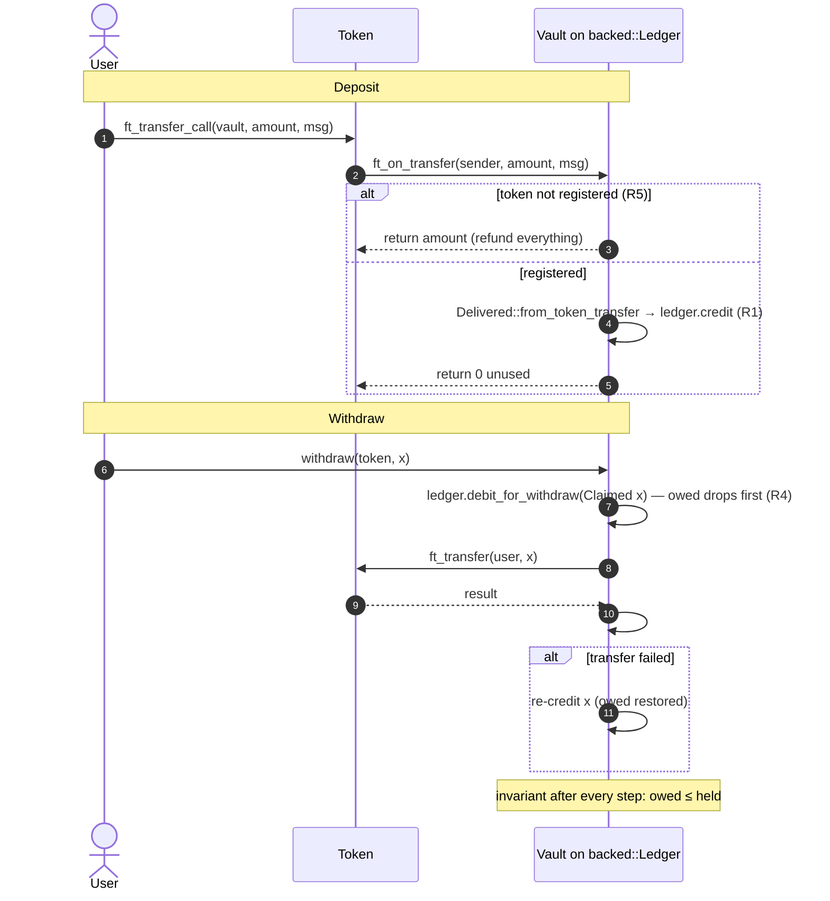

How amounts are typed, so the Rhea-style bug can't compile:

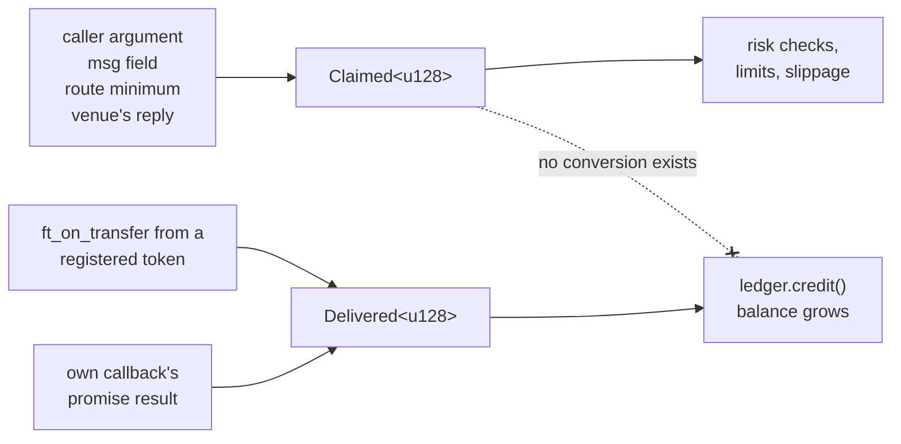

### 5. Proving it: the attack replay pipeline

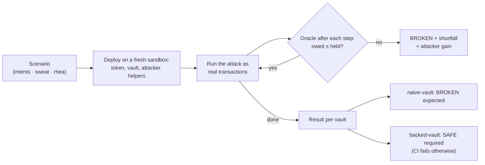

### 6. Daily monitoring workflow

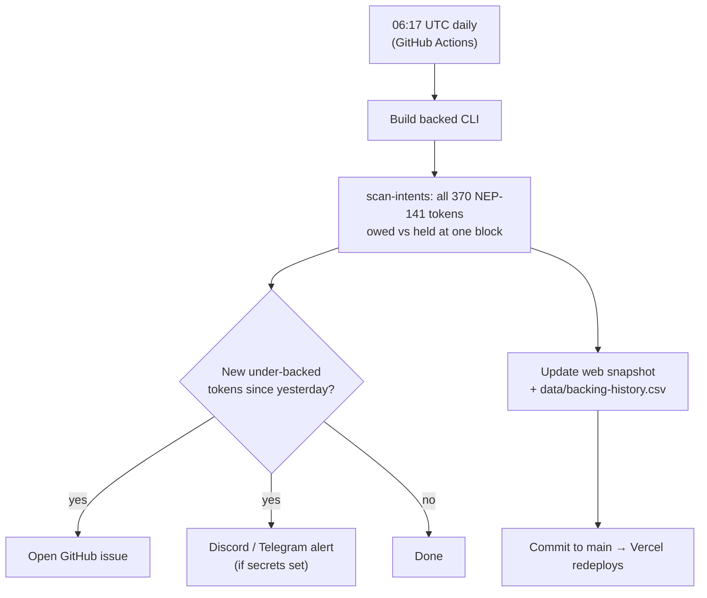

### 7. AI agent workflow (MCP)

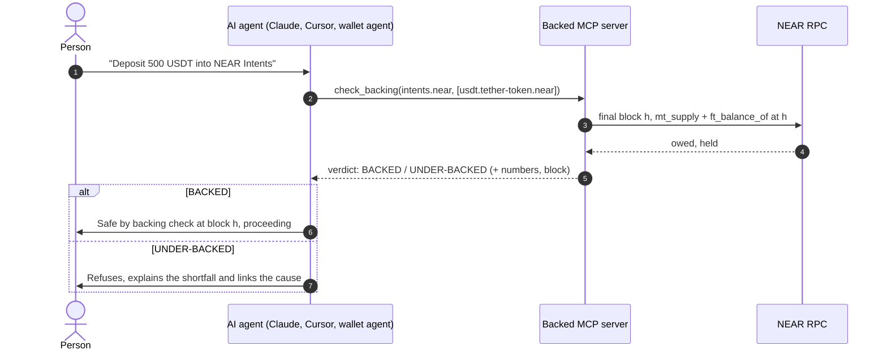

### 8. Developer workflow: from idea to verifiable contract

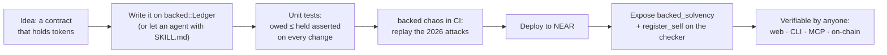

Full design: [`Idea/03-architecture.md`](Idea/03-architecture.md).

## Roadmap: next 4 weeks

Everything that's already shipped is listed under [what Backed does](#what-backed-does). The plan below covers only the four weeks after the hackathon (Nov 15 – Dec 12, 2026), and each item builds on code that already exists.

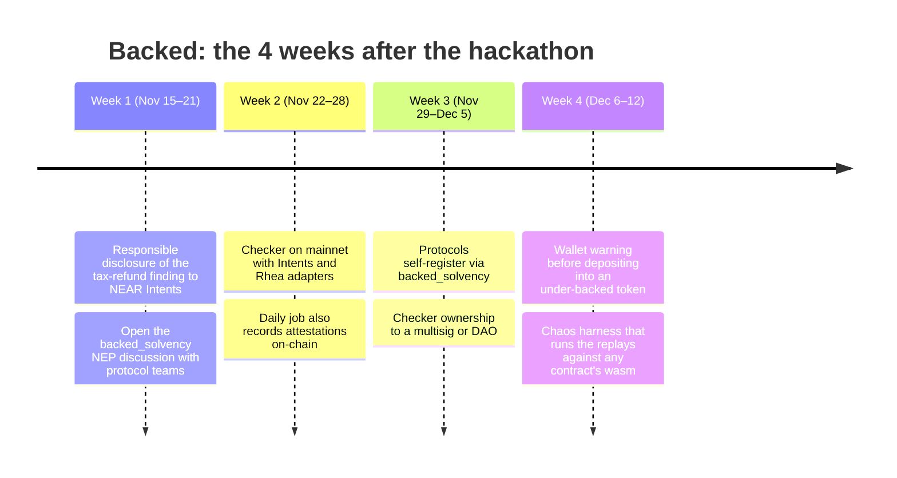

| Week | Item | Starting point today | Done when |
|---|---|---|---|
| **1** | Responsible disclosure of the tax-refund finding to NEAR Intents | Root cause traced to the transaction ([findings](docs/FINDINGS.md)) | Intents team has the report and the reproduction |
| **1** | NEP discussion with NEAR protocol teams | Draft spec [`docs/NEP-backed-solvency.md`](docs/NEP-backed-solvency.md) | Proposal posted for public discussion |
| **2** | Checker on mainnet | Same wasm as testnet; [checklist](docs/MAINNET.md) and `preflight` ready; needs ~2 NEAR | Intents and Rhea attestations on mainnet |
| **2** | Daily job also records attestations on-chain | `monitor.yml` scan + `attest` command | A mismatch in the daily scan triggers an on-chain `attest` |
| **3** | Protocols self-register via `backed_solvency` | `register_self` in the checker; `backed-vault` already reports through it | One external contract reports its books through the standard |
| **3** | Checker ownership to a multisig or DAO | `set_owner` / `get_owner` in the checker | Adapter management no longer depends on one key |
| **4** | Wallet warning before depositing into an under-backed token | `check_backing` in the hosted MCP server; CLI `--json` | A pre-deposit check a wallet or front-end can call, with a working example |
| **4** | Chaos harness that runs the replays against any contract's wasm | Replays run against `naive-vault` and `backed-vault` | `backed chaos --wasm <file>` replays the three attacks against your own vault |

## Repository layout

```
crates/backed/          library: Ledger, Delivered/Claimed, capped refunds, LogBudget, reconcile
crates/backed-chaos/    failure catalog F1–F8, invariant oracle, three replays, NEAR sandbox runner,
                        live deploy/attest tool (examples/live.rs)
crates/checker-logic/   checker logic shared by contract and CLI (adapters, parsing, breach rules)
contracts/checker/      checker contract (Intents, Rhea and Backed-standard adapters)
contracts/examples/     naive-vault (the three bug patterns, on purpose) and backed-vault
contracts/helpers/      test-token, evil-receiver, lying-venue (used by the replays only)
cli/                    backed CLI: check, scan-intents, scan-ref, chaos, attest, mcp
api/mcp.ts              hosted MCP server (Vercel function at /api/mcp); server.json for the MCP Registry
web/                    Vite + React app: home, live backing, checker (wallet), replays, build
skill/SKILL.md          instructions for AI coding agents
docs/                   draft NEP for backed_solvency, mainnet deploy checklist
data/                   daily backing history (written by the monitor workflow)
scripts/build-wasm.sh   builds every contract with cargo-near
.github/workflows/      CI (unit tests, sandbox replays, web build), daily scan, CLI release; Pages deploy (manual; the live site is on Vercel)
Idea/                   design documents, incl. user workflows
```

## Limits

- Backed isn't general contract security: oracle manipulation, bad liquidation math, governance attacks and key theft are out of scope.
- It holds no one's funds and can't pause other protocols. A protocol has to choose to read the checker.
- A lending protocol's bad debt shows up as a backing gap only once it's written off. The library prevents the bug at the source; the checker is the backstop.
- An under-backed reading on a small token can come from burns or transfer fees. Treat it as a finding to investigate.
- `naive-vault` and the helper contracts are deliberately vulnerable. Never deploy them with real funds.

## Hackathon

- **Event:** NEAR HACKATHON, Nov 1–14, 2026 (rules in [`HACKATHON.md`](HACKATHON.md))
- **Tracks:** Open Innovation, Unstoppable DeFi
- **NEAR features used:** async receipts and callbacks, NEP-141 / 145 / 245 / 297, cross-contract views, near-sdk 5.x, near-workspaces sandbox, wallet-selector

### Design documents

| | |
|---|---|
| [Problem and evidence](Idea/01-problem-and-evidence.md) | [Product](Idea/02-product.md) |
| [Architecture](Idea/03-architecture.md) | [Innovations](Idea/04-innovations.md) |
| [Why NEAR](Idea/05-why-near.md) | [Competitors](Idea/06-competitors.md) |
| [Deliverables and plan](Idea/07-deliverables-and-plan.md) | [Design audit](Idea/08-design-audit.md) |
| [Demo and pitch](Idea/09-demo-and-pitch.md) | [User workflows](Idea/10-user-workflows.md) |
| [Go-to-market and target users](Idea/11-go-to-market.md) | [Findings](docs/FINDINGS.md) |

## License

MIT or Apache-2.0, at your option, as declared in `Cargo.toml`. See [`LICENSE-MIT`](LICENSE-MIT) and the [Apache-2.0 text](https://www.apache.org/licenses/LICENSE-2.0).
